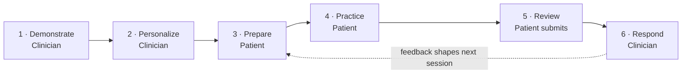
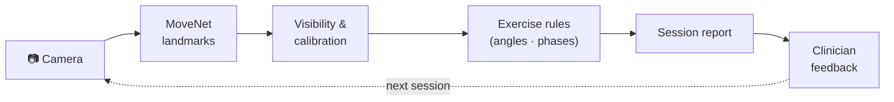
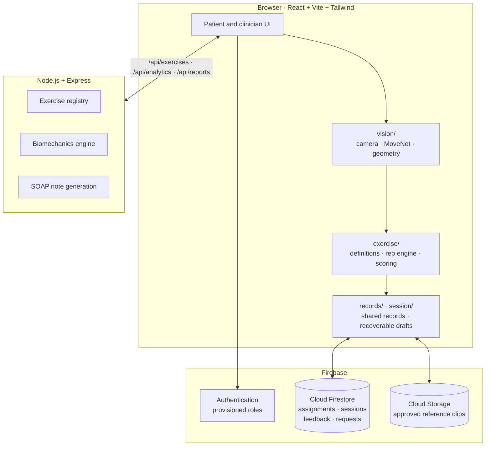
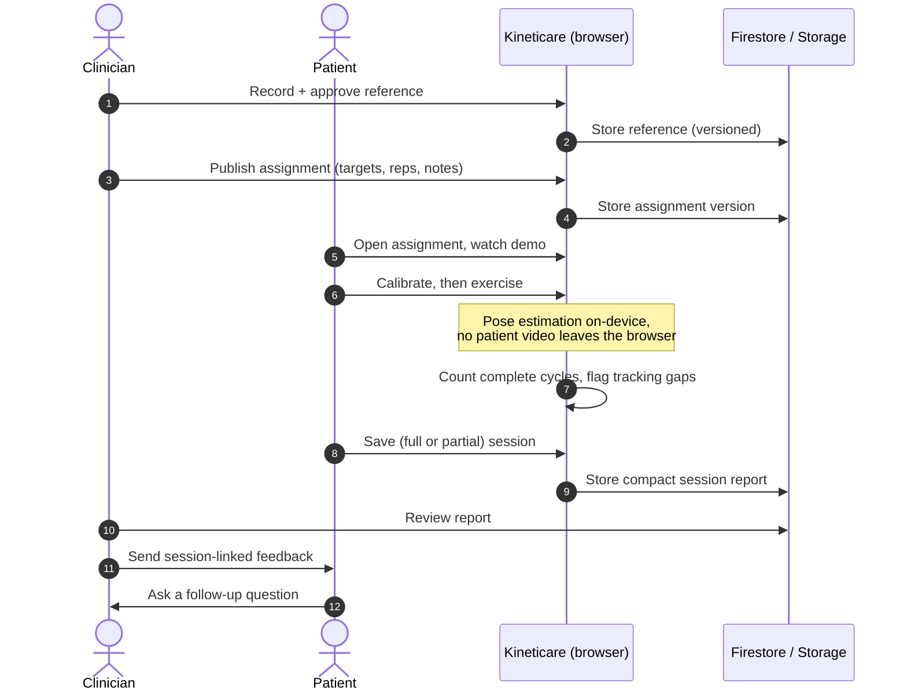

<div align="center">


# Kineticare

**From prescribed movement to meaningful feedback.**<br/>
Camera-guided home exercise that keeps patients and clinicians connected between appointments.

<br/>


**[The idea](#why-kineticare)** · **[Live walkthrough](#see-it-in-action)** · **[Care loop](#the-care-loop)** · **[Exercises](#supported-exercises)** · **[How it works](#how-it-works)** · **[Architecture](#architecture)** · **[Get started](#get-started)** · **[Roadmap](#roadmap)**

</div>

---

## See it in action

A patient calibrates, performs three arm raises with live landmark feedback, briefly steps out of frame (and the app says so instead of guessing), saves the session, and receives a reply from their clinician.

<div align="center">

<br/>
<sub>Authored illustration of the product flow. Numbers shown are illustrative and are not a recording of model inference.</sub>
</div>

---

## Why Kineticare?

An exercise plan is only the start of rehabilitation. At home, patients forget the demonstration, feel unsure about their movement, or struggle to describe what happened. Between appointments, clinicians have very little visibility into that practice.

**Kineticare closes that gap.** A reviewed demonstration becomes an individual assignment. Camera-observed movement becomes a concise session report. That report becomes a conversation with the clinician.

> Built around the **Devlympics** theme of *bridging a gap*: the distance between instructions given in a consultation and exercises practised at home. The goal is clearer guidance and more useful follow-up. Improvements in adherence, clinician workload, or recovery are outcomes to evaluate, not claims.

### At a glance

| | For patients | For clinicians |
| :-- | :-- | :-- |
| **Before** | Watch the approved demonstration, read notes, position the camera, calibrate | Record a reference once, approve it, set per-patient targets and schedule |
| **During** | Live landmarks, movement cues, rep progress, timing, optional voice cues | |
| **After** | See range, tempo and tracking gaps; get feedback; ask questions | Review a compact report, mark it reviewed, send session-linked feedback |
| **Between visits** | Resume interrupted sessions, browse history and progress | Dashboard of linked patients, incomplete work, and requests |

---

## The care loop



| Stage | What happens | What carries forward |
| :-- | :-- | :-- |
| **1 · Demonstrate** | A clinician records and approves an exercise reference | A playable, versioned demonstration |
| **2 · Personalize** | The clinician chooses targets, repetitions, schedule, and notes | A patient-specific assignment |
| **3 · Prepare** | The patient watches instructions, positions the camera, and calibrates | A stable starting pose |
| **4 · Practice** | The app follows supported movement and provides cues | Repetitions, range, tempo, and timing |
| **5 · Review** | The patient submits a completed or partial session | A compact report with tracking gaps |
| **6 · Respond** | The clinician reviews the record and sends feedback | Guidance the patient can read and question |

---

## Explore the experience

<table>
<tr>
<td width="50%" valign="top">

### 🧑 Patient
*Know what to do. See what happened.*

- **Assigned plan:** view the plan, read clinician notes, and replay the approved reference before starting
- **Guided setup:** a preparation checklist and stable-rest calibration establish the required camera view
- **Live practice:** body landmarks, movement cues, repetition progress, and timing
- **Two views:** switch between the camera overlay and a skeleton view
- **In control:** optional spoken cues, plus pause, resume, or stop early
- **Honest summary:** completed work, range and tempo components, and the periods when tracking was unavailable
- **Never lose a session:** recovery drafts protect interrupted workouts; history and progress keep saved work
- **Stay connected:** read feedback, ask session questions, and send help requests

</td>
<td width="50%" valign="top">

### 🩺 Clinician
*Demonstrate once. Personalize. Follow up.*

- **Capture references in-app:** mark five repetitions, preview the recording, then approve or reject it
- **Reference ≠ target:** an approved reference is the demonstration; each patient's target stays an individual choice
- **Assignment drafts:** choose a reference, repetitions, targets, and notes, then preview before publishing
- **Versioned assignments:** published assignments are preserved so later edits never rewrite the meaning of earlier sessions
- **One dashboard:** linked patients, session history, incomplete work, and requests
- **Close the loop:** review measurements, mark sessions reviewed, send session-linked feedback, and reply to questions
- **SOAP notes and issue reports** generated by the backend services

</td>
</tr>
</table>

<details>
<summary><b>▶ Walk through a complete demonstration (8 steps)</b></summary>

<br/>

1. Enter the **clinician** account and capture an approved exercise reference.
2. Select a patient, draft an assignment, preview it, and publish.
3. Enter the matching **patient** account and watch the demonstration.
4. Complete positioning and calibration, then perform the assigned movement.
5. Try pause/resume, camera/skeleton switching, and a brief tracking interruption.
6. Save the session and inspect its measurements and history.
7. Return as the clinician, review the report, and send feedback.
8. Return as the patient, read the response, and ask a question.

The browser-local demo provides one clinician and two separate patient accounts. **Firebase mode** supports shared records across devices.

</details>

---

## Supported exercises

The MVP focuses on two movements, each with explicit camera requirements and measurement rules.

<div align="center">

</div>

| Exercise | Camera view | What the app follows |
| :-- | :-- | :-- |
| **Squat / mini-squat** | Side | Knee-angle excursion and a complete lowering/return cycle |
| **Bilateral side arm raise** | Front | Shoulder elevation and a complete raise/return cycle |

Each exercise has its own required landmarks, calibration, movement phases, and cues. The assigned exercise selects those rules; Kineticare does **not** try to classify arbitrary exercises.

---

## How it works



**MoveNet SinglePose Lightning** estimates body landmarks in the browser. Kineticare checks that the relevant joints are visible, derives exercise-specific angles, and tracks movement phases relative to the patient's calibration and assignment.

A repetition is counted only from a **complete configured movement cycle**. When tracking becomes unreliable, the app says it cannot assess the movement and **discards the incomplete cycle** rather than joining motion across a gap.

### Understand the session report

| Measurement | Meaning |
| :-- | :-- |
| **Repetitions** | Completed cycles detected by the configured exercise rules |
| **Active time** | Assessed movement time while tracking is usable |
| **Pauses and elapsed time** | How the session was spent beyond active movement |
| **Tracking gaps** | Time when required landmarks could not be assessed |
| **Range and tempo** | Observed movement relative to the assigned target |
| **Prototype score** | An explained summary of configured movement criteria |

> [!IMPORTANT]
> These observations support clinician review. They do **not** establish diagnosis, treatment effectiveness, or complete movement safety.

### What makes it useful

- **Context travels with the data.** A rep counter alone can't say which assignment was followed, and a raw recording asks someone to watch the whole session. Reference and assignment versions give the compact report its meaning.
- **Missing information is visible.** Partial sessions can be saved, pauses stay distinct from active time, and tracking gaps appear in the report, so nobody mistakes "camera open" for "exercise completed".

---

## Architecture



<details>
<summary><b>Sequence of one session</b></summary>



</details>

---

## Privacy and safety by design

- **On-device vision.** Patient camera frames are processed in the browser. Raw patient workout video is **not recorded or uploaded** by default.
- **Only approved clips are stored.** Explicitly approved clinician reference recordings are kept for authorized playback.
- **Role-scoped access.** Roles and clinician–patient relationships are provisioned through a trusted process; Firestore and Storage rules restrict records and reference media to the relevant accounts (`firestore.rules`, `storage.rules`).
- **Claims stay modest.** Measurements assist review; they are not a diagnosis.

---

## Tech stack

| Layer | Implementation |
| :-- | :-- |
| **Interface** | React, Vite, Tailwind CSS, responsive patient and clinician white-mode UI |
| **Backend & API** | Node.js, Express REST API, modular Exercise Registry, Biomechanics Engine |
| **Pose estimation** | TensorFlow.js with MoveNet SinglePose Lightning (on-device, WebGL) |
| **Movement logic** | Exercise-specific geometry, calibration, concentric/eccentric phases, fatigue scoring |
| **Identity** | Firebase Authentication with provisioned roles (demo: Patient *Shyam Yadav*, Clinician *Dr. Aditi Singh*) |
| **Shared records** | Cloud Firestore: assignments, sessions, clinical feedback, requests |
| **Reference media** | Protected Cloud Storage in Firebase mode; IndexedDB and local staging fallback |

<details>
<summary><b>Project structure</b></summary>

```text
backend/
  config/        Server and environment definitions
  routes/        Express routers: /api/exercises, /api/analytics, /api/reports
  services/      Exercise registry, biomechanical calculation, SOAP note generation
  server.js      Production fullstack server
frontend/
  src/
    auth/        Account and role state
    client/      Clinician dashboard, patient drilldowns, reference capture
    patient/     Setup, live practice, summaries, recovery progress
    exercise/    Exercise definitions, repetition engine, scoring
    vision/      Camera lifecycle, MoveNet, geometry
    records/     Shared records and local workspace state
    services/    Backend API client, Firebase, media storage
    session/     Recoverable workout drafts
  test/          Logic and security-rule checks
docs/assets/     README animations and project illustrations
firebase.json · firestore.rules · firestore.indexes.json · storage.rules
overview.md · plan.md · .env.example
```

</details>

---

## Get started

> Full installation, run commands, Firebase setup, and checks live in the **[frontend README](frontend/README.md)**. The quick start below is the short version.

```bash
git clone https://github.com/dipesh4000/Kineticare.git
cd Kineticare

cp .env.example .env     # add your Firebase config if you want shared (Firebase) mode
bun install              # or: npm install
bun run dev              # see frontend/README.md for the exact scripts
```

| Mode | What you get |
| :-- | :-- |
| **Browser-local demo** | One clinician and two patient accounts, data kept in the browser; ideal for trying the full loop on one machine |
| **Firebase mode** | Real authentication, shared Firestore records, and protected reference media across devices |

---

## Roadmap

- [x] Camera-guided workflow with calibration and live cues
- [x] Reference capture and playback, versioned assignments
- [x] Live camera measurements, tracking-gap reporting, recoverable sessions
- [x] Clinician review, feedback, patient requests, SOAP note generation, exercise issue reporting
- [ ] **Clinician custom video upload (Phase 2).** Stage 1 preview with local staging is available in the Exercise Library; persistent cloud transcoding, adaptive streaming, and multi-tenant distribution are planned
- [ ] **Dynamic exercise expansion.** Push new protocols via `backend/services/exerciseRegistry.js` or `POST /api/exercises`
- [ ] **EHR integration.** Export structured SOAP notes to FHIR-compliant records
- [ ] **Native mobile apps.** Cross-platform wrappers (React Native / Capacitor) on the responsive web foundation

---

## Documentation

| Read | For |
| :-- | :-- |
| [Frontend README](frontend/README.md) | Installation, run commands, Firebase setup, and checks |
| [Project overview](overview.md) | Problem, users, product decisions, and demonstration narrative |
| [Implementation plan](plan.md) | Architecture, record contracts, permissions, and release gates |

The overview and plan retain the original planning baseline; current behaviour is established by the code and verified checks.

---

## Credits

Forked from [garvitsingh006/Kineticare](https://github.com/garvitsingh006/Kineticare). Pose estimation uses Google's [MoveNet](https://www.tensorflow.org/hub/tutorials/movenet) via TensorFlow.js.

<div align="center">

<br/>

**Demonstrate · Practice · Understand · Respond**

</div>