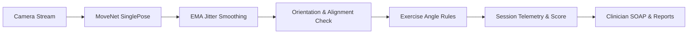

<p align="center">
  
</p>

<h1 align="center">Kineticare</h1>
<p align="center"><strong>From prescribed movement to meaningful feedback.</strong></p>
<p align="center">Camera-guided home exercise connecting physical therapy patients and clinicians between appointments.</p>

<p align="center">
  <a href="#why-kineticare">The idea</a> ·
  <a href="#system-architecture">Architecture</a> ·
  <a href="#explore-the-experience">The experience</a> ·
  <a href="#how-it-works">The technology</a> ·
  <a href="#production-deployment--mobile-apk-workflow">Deployment & APK</a> ·
  <a href="DEPLOYMENT.md">Complete Deployment Guide</a>
</p>

<p align="center">
  
  <br><sub>Illustrated MoveNet workflow · On-device pose estimation with zero cloud video upload</sub>
</p>

---

## Why Kineticare?

An exercise plan is only the start of rehabilitation. At home, patients can forget the demonstration, feel unsure about their movement, or struggle to describe what happened. Between appointments, clinicians have limited visibility into that practice.

Kineticare connects those moments. A reviewed demonstration becomes an individual assignment; camera-observed movement becomes a concise session report; that report becomes an actionable conversation with the clinician.

The project bridges the distance between instructions given in a clinical consultation and exercises practiced at home, emphasizing objective telemetry over subjective recall while protecting patient privacy.

---

## Use Case

Kineticare supports rehabilitation exercises at home between clinician appointments. Clinicians onboard patients, assign exercise plans and reference demonstrations, then review session results and send feedback. Patients follow their plan, use camera guidance to track repetitions and movement quality, monitor progress, and message their clinician.

## System Architecture

- **Frontend:** A React single-page app with separate patient and clinician routes. TensorFlow.js runs MoveNet in the browser through WebGL; exercise rules turn pose landmarks into repetitions, range-of-motion metrics, and feedback. Live camera frames stay on the device.
- **Records and authentication:** Demo mode stores records in browser localStorage and reference media in IndexedDB. With Firebase configured, Firebase Authentication handles sign-in, Firestore synchronizes clinical records, and Cloud Storage stores clinician reference recordings.
- **Backend:** A Node.js/Express API serves exercise catalog, session analytics, SOAP-note generation, and exercise issue-reporting endpoints under `/api`. The frontend can use `VITE_API_BASE_URL` for a separate API host and falls back to shared local analytics when the API is unavailable. Express can also serve the built frontend.

```text
Camera → MoveNet (browser/WebGL) → Exercise engine → Patient / clinician UI
                                                        ├─ Demo: localStorage + IndexedDB
                                                        ├─ Connected: Firebase Auth + Firestore + Storage
                                                        └─ Express /api: catalog, analytics, SOAP, reports
```

---

## The Care Loop

| Stage | What happens | What carries forward |
| --- | --- | --- |
| **Demonstrate** | A clinician records and approves an exercise reference | A playable, versioned demonstration |
| **Personalize** | The clinician chooses targets, repetitions, schedule, and notes | A patient-specific assignment |
| **Prepare** | The patient positions the camera, validates orientation, and calibrates | A stable starting pose |
| **Practice** | The app follows movement with temporal EMA smoothing and cues | Repetitions, range, tempo, and fatigue |
| **Review** | The patient submits a completed or partial session | A compact report with tracking gaps |
| **Respond** | The clinician reviews the record, generates SOAP notes, or flags issues | Guidance the patient can read and question |

---

## Explore the Experience

### Patient Portal (Dipesh)
- **Guided Exercise Plans**: View assigned daily routines, review attending clinician instructions, and watch approved reference videos.
- **Robust Camera Experience**: Automatic distance and side-profile alignment checks ensure accurate planar joint angles before practice begins.
- **Live Form Guidance**: Real-time angle telemetry with Exponential Moving Average (EMA) jitter suppression, visual progress rings, and optional spoken coaching.
- **Recovery & Gaps**: Interrupted sessions save as resumable drafts; incomplete cycles or occlusions are reported transparently.

### Clinician Portal (Dr. Aditi Yadav)
- **Caseload Dashboard**: Review patient compliance, range of motion (ROM) progression, and sessions requiring clinical review.
- **Exercise Reporting Workflow**: Flag protocol concerns, patient discomfort, tracking occlusion, or contraindications directly from the Exercise Library (`POST /api/reports/exercise`).
- **Demonstration Video Staging**: Preview and stage custom clinician demonstration recordings.
- **Automated SOAP Notes**: Instant clinical summaries formatted into Subjective, Objective, Assessment, and Plan for medical documentation.

---

## Supported Exercises & Biomechanics

| Exercise | Camera view | Biomechanical Joint Tracked |
| --- | --- | --- |
| **Squat / mini-squat** | Side | Knee flexion angle excursion and lowering/return timing |
| **Bilateral side arm raise** | Front | Bilateral shoulder abduction and raise/return cycle |
| **Standing toe touch** | Side | Hip flexion angle excursion and forward bend rhythm |

---

## How It Works



1. **MoveNet SinglePose Lightning** executes directly inside the browser or mobile web view via WebGL.
2. **Temporal EMA Smoothing** ($\alpha = 0.35$) eliminates frame-to-frame keypoint noise without introducing latency.
3. **Body Orientation Validator** analyzes torso and shoulder spread ratios to alert patients if they are facing the wrong direction for side-view exercises.
4. **Repetition Engine** tracks concentric vs. eccentric durations, dwell times, and fatigue indices across repetitions.
5. **Session Submission** dispatches structured JSON metrics to the backend API without uploading raw video.

---

## Technology Stack and Dependencies

| Dependency | Purpose |
| --- | --- |
| React 19, React DOM, React Router 7 | Patient and clinician interfaces and routing |
| TensorFlow.js 4, pose-detection 2, WebGL backend | On-device MoveNet pose estimation |
| Firebase 13 | Authentication, Firestore records, and reference media storage |
| Express 5 on Node.js | REST API and production static-file serving |
| Vite 8, React Vite plugin, Tailwind CSS 4 | Development server, builds, and styling |
| ESLint 10, Node test runner | Linting and exercise/patient-flow checks |
| Firebase CLI and rules-unit-testing | Firestore emulator security-rule tests |

Use Node.js and npm to install dependencies with `npm install`. Run `npm run dev` for the frontend, `npm run build` to build it, and `npm start` for Express. Checks are available through `npm test` and `npm run lint`.

The `backend/db/` directory contains Neon PostgreSQL/Drizzle scaffolding, but its packages are not declared in the current manifests and the API routes do not use it. Current application records use the browser demo workspace or Firebase.

---

## Project Structure

```text
backend/
  config/      Server configuration and environment bindings
  db/          Neon PostgreSQL client and Drizzle ORM schema (users, plans, sessions, reports)
  routes/      Express routers: /api/exercises, /api/analytics, /api/reports, /api/health
  services/    Exercise registry, biomechanical calculations, SOAP note generation
  vercel.json  Vercel serverless deployment configuration
  server.js    Production fullstack server
frontend/
  public/      PWA manifest.json, brand icons, video demonstration assets
  src/
    auth/      Authentication context (Dipesh & Dr. Aditi Yadav)
    client/    Clinician dashboard, patient drilldowns, and reference capture
    components/PWAInstallButton, exercise telemetry charts, video player
    patient/   Setup, live practice with EMA smoother, summaries, and recovery progress
    exercise/  Exercise definitions, repetition engine, scoring
    vision/    Camera lifecycle, MoveNet, geometry, EMA filter, orientation validator
    records/   Shared records and local workspace state
    services/  Configurable API client (supports VITE_API_BASE_URL), Firebase, and media
    session/   Recoverable workout drafts
  test/        Automated biomechanics and security-rule checks
docs/          Project documentation and diagrams
DEPLOYMENT.md  Comprehensive deployment and APK packaging guide
```

---

## Production Deployment & Mobile APK Workflow

For the complete, step-by-step deployment instructions, refer to **[DEPLOYMENT.md](DEPLOYMENT.md)**.

### Summary:

1. **Connected Records (Firebase)**:
   - Configure the frontend's `VITE_FIREBASE_*` variables for Authentication, Firestore, and Cloud Storage, and deploy the repository's security rules.
   - Without Firebase configuration, the app uses browser-local demo records. Neon/Drizzle scaffolding requires additional dependencies and API integration before use.
2. **Backend Deployment (Vercel)**:
   - Deploy `backend/` to Vercel for the Express API.
   - Pre-configured `backend/vercel.json` serves the API at `https://your-backend.vercel.app/api/*`.
3. **Frontend & Mobile APK**:
   - Set `VITE_API_BASE_URL=https://your-backend.vercel.app` in `frontend/.env.production`.
   - Build static assets with `npm run build --workspace=frontend`.
   - Use [PWABuilder.com](https://www.pwabuilder.com) to package the live HTTPS URL into an installable Android APK (`.apk`) or Google Play Store bundle (`.aab`).

---

## Scope and Roadmap

- **Doctor Custom Video Upload (Phase 2)**: Stage 1 preview with local staging is currently active in the Exercise Library. Persistent cloud transcoding, adaptive streaming, and multi-tenant video distribution are scheduled for Phase 2.
- **Dynamic Exercise Expansion**: Developers can push new protocols directly via `backend/services/exerciseRegistry.js` or `POST /api/exercises`.
- **EHR Integration**: Export structured clinical SOAP notes to FHIR-compliant electronic medical records.
- **Direct Native Push Notifications**: Native push notifications for prescribed workout reminders in the installed APK.

---

## Documentation

| Document | Description |
| --- | --- |
| **[DEPLOYMENT.md](DEPLOYMENT.md)** | Step-by-step Neon DB, Vercel backend, and APK packaging guide |
| **[Frontend README](frontend/README.md)** | Local installation, run commands, and test checks |
| **[Project Overview](overview.md)** | Product vision, clinical rationale, and user journeys |
| **[Implementation Plan](plan.md)** | Baseline development roadmap and milestones |

---

<p align="center"><strong>Demonstrate. Practice. Understand. Respond.</strong></p>
