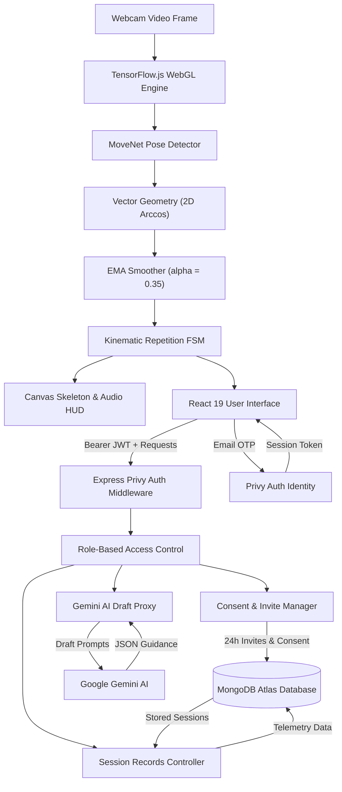
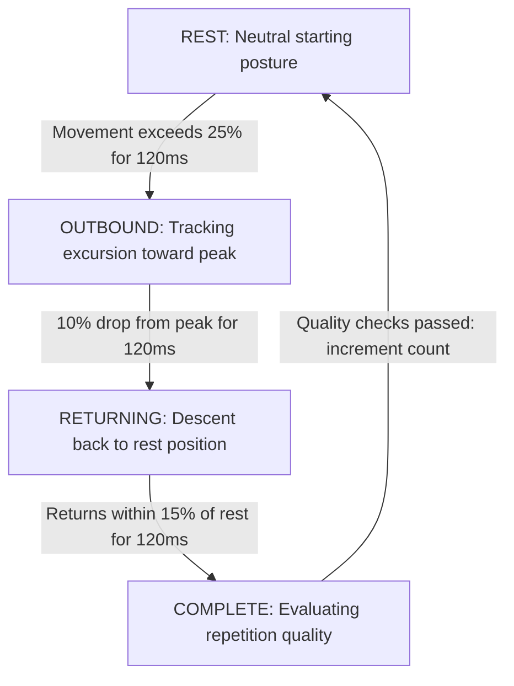
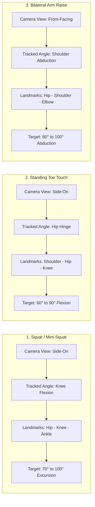
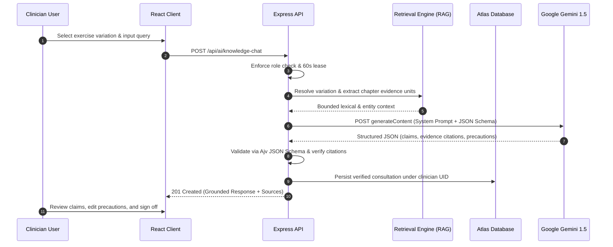
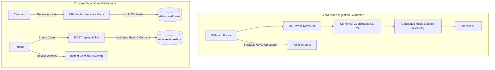
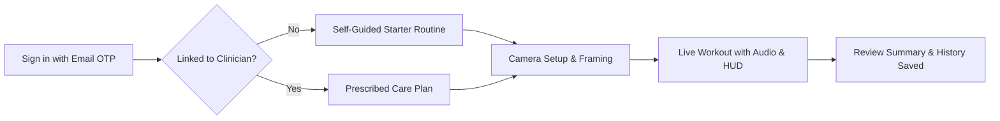
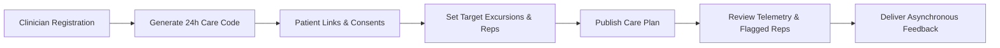

# ⚡ Kineticare
### *Next-Generation Computer Vision Tele-Rehabilitation & Clinician-Guided Home Exercise Platform*

---

[](https://nodejs.org/)
[](https://react.dev/)
[](https://vitejs.dev/)
[](https://www.tensorflow.org/js)
[](https://expressjs.com/)
[](https://www.mongodb.com/atlas)
[](https://privy.io/)
[](https://deepmind.google/technologies/gemini/)
[](https://web.dev/progressive-web-apps/)
[](https://tailwindcss.com/)

---

## 📋 Table of Contents

1. [Executive Summary & The Care Crisis](#-executive-summary--the-care-crisis)
2. [Key Architectural Pillars](#-key-architectural-pillars)
3. [End-to-End System Architecture](#-end-to-end-system-architecture)
   - [Visual Data Pipeline](#visual-data-pipeline)
   - [Component Flowchart](#component-flowchart)
4. [Computer Vision & Biomechanics Engine](#-computer-vision--biomechanics-engine)
   - [MoveNet 17-Keypoint Anatomical Mapping](#1-movenet-17-keypoint-anatomical-mapping)
   - [Joint Angle Mathematics (2D Arccos Vector Geometry)](#2-joint-angle-mathematics)
   - [Real-Time Signal Filtering (EMA Smoother)](#3-signal-smoothing-ema-filter)
   - [Kinematic Repetition Finite State Machine (FSM)](#4-repetition-finite-state-machine-fsm)
   - [Framing & Stance Alignment Verification](#5-framing--stance-alignment-verification)
5. [Supported Clinical Exercise Library](#-supported-clinical-exercise-library)
6. [Knowledge-Grounded Clinical AI Assistant (RAG + Gemini)](#-knowledge-grounded-clinical-ai-assistant-rag--gemini)
   - [Retrieval-Augmented Architecture](#retrieval-augmented-architecture)
   - [Ajv Schema Validation & Anti-Hallucination Guardrails](#ajv-schema-validation--anti-hallucination-guardrails)
7. [Procedural Motion Generation & Animation Engine](#-procedural-motion-generation--animation-engine)
8. [Mobile Progressive Web App (PWA) & Offline Shell](#-mobile-progressive-web-app-pwa--offline-shell)
9. [Security, Privacy & Consent Architecture](#-security-privacy--consent-architecture)
   - [Zero-Video Ingestion Guarantee](#1-zero-video-ingestion-guarantee)
   - [Cryptographic 24-Hour Single-Use Invites](#2-cryptographic-24-hour-single-use-invites)
   - [Sovereign Patient Consent & Revocation](#3-sovereign-patient-consent--revocation)
10. [Database Schemas & Data Modeling (MongoDB Atlas)](#-database-schemas--data-modeling-mongodb-atlas)
11. [REST API Specification](#-rest-api-specification)
12. [User Journeys & Workflow Specifications](#-user-journeys--workflow-specifications)
    - [Patient Experience (Self-Guided vs. Prescribed)](#1-patient-journey)
    - [Clinician Care Management & Review Queue](#2-clinician-journey)
13. [Healthcare Economics & Reimbursement (CPT Codes)](#-healthcare-economics--reimbursement-cpt-codes)
14. [Local Developer Quick Start](#-local-developer-quick-start)
    - [Prerequisites](#prerequisites)
    - [Environment Setup](#environment-setup)
    - [Running Locally](#running-the-application)
15. [Verification & Comprehensive Test Suite](#-verification--comprehensive-test-suite)
16. [Production Deployment Architecture](#-production-deployment-architecture)
17. [Troubleshooting & Frequently Asked Questions](#-troubleshooting--faqs)
18. [Clinical Disclaimers & Regulatory Boundary](#-clinical-disclaimers--regulatory-boundary)

---

## 🌟 Executive Summary & The Care Crisis

In orthopedic and neurological rehabilitation, **65% to 80% of patients fail to adhere to prescribed Home Exercise Programs (HEP)**. Paper instruction handouts are frequently misplaced, patients forget proper joint alignment between visits, and clinicians have virtually zero visibility into exercise quality until follow-up appointments weeks later.

```
+─────────────────────────────────────────────────────────────────────────+
|                           THE KINETICARE BRIDGE                         |
|                                                                         |
|  CLINICIAN CLINICAL DESK                 PATIENT PRACTICE ENVIRONMENT   |
|  • Prescribe exact angular excursions    • On-device MoveNet tracking   |
|  • Inspect exception-flagged reps        • Real-time audio & HUD cues   |
|  • Send asynchronous feedback            • Zero video leaves browser    |
|          ▲                                          │                   |
|          └─────────────[ EXPRESS 5 API ]────────────┘                   |
|                      Consent-Gated Telemetry                            |
+─────────────────────────────────────────────────────────────────────────+
```

**Kineticare bridges this divide** by converting any commodity webcam (laptop, tablet, or smartphone) into an edge-computed clinical guidance tool. It couples client-side computer vision with a consent-gated clinician dashboard, transforming unmonitored home practice into actionable, reimbursable clinical telemetry without invading patient privacy.

---

## 🛡 Key Architectural Pillars

* 🔒 **Zero-Video Ingestion Guarantee:** 100% of computer vision runs on-device in WebGL using TensorFlow.js and MoveNet. Raw camera video **never leaves the user's browser memory**. Only lightweight numerical metrics (timestamps, joint excursions, cadence) are transmitted.
* 📐 **Sub-Millisecond Biomechanical Analysis:** Calculates real-time anatomical angles (knee flexion, hip hinge, shoulder abduction), eccentric-to-concentric cadence ratios, and Range of Motion (ROM) deficits.
* 🩺 **Clinician-in-the-Loop Workflow:** Clinicians prescribe tailored targets, review highlighted outliers (e.g., rapid eccentric collapse, target shortfalls), and provide targeted feedback without reviewing hours of video.
* 📚 **Evidence-Grounded AI Assistant:** Powered by Google Gemini and a 25-chapter physical therapy knowledge base, clinicians can draft structured, textbook-cited exercise education with strict human review sign-off.
* 📱 **Cross-Platform PWA:** Built with responsive modern web standards, installable on mobile devices with offline fallback support.

---

## 🏛 End-to-End System Architecture

### Visual Data Pipeline

```
+─────────────────────────────────────────────────────────────────────────+
|                  PATIENT & CLINICIAN BROWSER (React 19)                 |
|                                                                         |
|  [ Webcam Stream ]                                                      |
|         │                                                               |
|         ▼                                                               |
|  [ TensorFlow.js (WebGL) ] ──▶ [ MoveNet Pose (17 Keypoints) ]          |
|                                       │                                 |
|                                       ▼                                 |
|  [ UI & Audio Cues ] ◀── [ Rep FSM ] ◀── [ Vector Geometry & EMA ]      |
+───────────────────────────────────┬─────────────────────────────────────+
                                    │ HTTP / Bearer JWT
                                    ▼
+─────────────────────────────────────────────────────────────────────────+
|                    EXPRESS 5 BACKEND API (Port 3001)                    |
|                                                                         |
|  [ Privy Auth Middleware ] ──▶ [ Role-Based Access Control (RBAC) ]     |
|                                       │                                 |
|         ┌─────────────────────────────┼─────────────────────────────┐   |
|         ▼                             ▼                             ▼   |
|  [ Consent Manager ]        [ Session Records ]             [ AI Proxy ]|
+─────────┬─────────────────────────────┬─────────────────────────────┬───+
          │                             │                             │
          ▼                             ▼                             ▼
+──────────────────────────+  +──────────────────────────+  +────────────+
|   MongoDB Atlas (DB)     |  |   Privy Cloud (Identity) |  | Google AI  |
|   Users, Relationships,  |  |   Passwordless Email OTP |  | Gemini     |
|   Sessions & Plans       |  |   & Session Tokens       |  | Clinical   |
+──────────────────────────+  +──────────────────────────+  +────────────+
```

### Component Flowchart



---

## 👁 Computer Vision & Biomechanics Engine

### 1. MoveNet 17-Keypoint Anatomical Mapping

MoveNet computes coordinates `(x, y)` and confidence scores `score in [0, 1]` for 17 anatomical landmarks in real time:

```
                  [0] Nose
              [1] L.Eye     [2] R.Eye
              [3] L.Ear     [4] R.Ear
                   \         /
             [5] L.Shoulder ─── [6] R.Shoulder
             │       │              │       │
             │   [7] L.Elbow    [9] R.Elbow │
             │       │              │       │
             │   [8] L.Wrist   [10] R.Wrist │
             │                              │
            [11] L.Hip ────────── [12] R.Hip
                  │                    │
             [13] L.Knee          [14] R.Knee
                  │                    │
             [15] L.Ankle         [16] R.Ankle
```

### 2. Joint Angle Mathematics
Joint angles are calculated dynamically using the 2D dot product between directional limb vectors:

Given vertex joint $V$ and adjacent joints $A$ and $B$:
* Vector $\vec{u} = A - V = (x_a - x_v, \; y_a - y_v)$
* Vector $\vec{w} = B - V = (x_b - x_v, \; y_b - y_v)$

$$\theta = \arccos\left( \frac{\vec{u} \cdot \vec{w}}{\|\vec{u}\| \|\vec{w}\|} \right) \times \frac{180^\circ}{\pi}$$

* **Safety Quotient Clamping:** To prevent floating-point inaccuracies from generating `NaN` values, the cosine quotient is clamped strictly to the range `[-1.0, 1.0]`.
* **Visibility Threshold:** Computations execute only when all 3 landmarks exceed the minimum confidence score threshold (`score >= 0.30`).

### 3. Signal Smoothing (EMA Filter)
Webcam landmark signals can produce micro-jitter under uneven lighting. Kineticare applies an **Exponential Moving Average (EMA)** with dynamic step-limiting:

$$\theta_{filtered}(t) = \alpha \cdot \theta_{clamped}(t) + (1 - \alpha) \cdot \theta_{filtered}(t - 1)$$

* **Smoothing Factor:** $\alpha = 0.35$ balances responsiveness with jitter suppression.
* **Slew-Rate Limiter:** If $|\theta(t) - \theta(t-1)| > 45^\circ$, the change is step-limited to $45^\circ$ to prevent tracking glitch artifacts from triggering false reps.

---

### 4. Repetition Finite State Machine (FSM)

Repetitions are tracked using a dwell-state hysteresis automaton:

```
   +──────────────────────────────────────────────────────────────+
   |                                                              |
   |   [ REST ] ──(exceeds 25% excursion for 120ms)──▶ [ OUTBOUND ]
   |      ▲                                                 │     |
   |      │                                                 │     |
   |   (within 15% of rest                            (10% drop   |
   |    for 120ms)                                     from peak) |
   |      │                                                 │     |
   |      │                                                 ▼     |
   |   [ COMPLETE ] ◀─────────────────────────────── [ RETURNING ]|
   |                                                              |
   +──────────────────────────────────────────────────────────────+
```



#### State Machine Quality Gates
| Gate | Parameter | Operational & Clinical Purpose |
| :--- | :--- | :--- |
| **Enter Threshold** | `0.25` ($25\%$) | Ignores natural resting tremors and minor postural adjustments |
| **Reversal Drop** | `0.10` ($10\%$) | Confirms movement direction reversal from peak joint extension/flexion |
| **Exit Threshold** | `0.15` ($15\%$) | Requires complete return to neutral stance before concluding rep |
| **Dwell Time** | `120 ms` | Eliminates single-frame landmark flicker spikes |
| **Minimum Duration** | `600 ms` | Rejects abrupt camera bumps, sensor drops, or spasms |
| **Plausibility Gate** | `1.6 * Target` | Discards anatomically impossible joint hyperextensions |

---

### 5. Framing & Stance Alignment Verification

Before and during exercise execution, automated geometry checks validate user positioning:

```
   SIDE VIEW ALIGNMENT CHECK:
   
   Proper Side Stance:              Accidental Front-Facing Stance:
        [Shoulders Aligned]             [Shoulders Wide Apart]
             O                               O
            /|                               |\
             |                              / | \
            / \                            /  |  \
   Δx(Shoulders) / Δy(Torso) <= 0.45    Δx(Shoulders) / Δy(Torso) > 0.45
   ==> Stance Approved                  ==> Prompt: "Turn side-on to camera"
```

* **Framing Distance:** Calculates vertical distance from nose to ankles. If total height exceeds $95\%$ of canvas height, the app prompts: *"Step back so full body fits in frame"*. If $< 40\%$, it prompts: *"Step closer to camera"*.

---

## 🏃 Supported Clinical Exercise Library



| Exercise Name | Camera View | Joint Angle Tracked | Primary Anatomical Triad | Typical Clinical Target | Common Compensation Risks |
| :--- | :--- | :--- | :--- | :--- | :--- |
| **Squat / Mini-Squat** | Side-On | Knee Flexion | Hip $\rightarrow$ Knee $\rightarrow$ Ankle | $70^\circ - 100^\circ$ excursion | Knee valgus collapse, heel rise, forward trunk lean |
| **Standing Toe Touch** | Side-On | Hip Flexion / Hinge | Shoulder $\rightarrow$ Hip $\rightarrow$ Knee | $60^\circ - 90^\circ$ flexion | Excessive lumbar rounding instead of hip hinge |
| **Bilateral Side Arm Raise**| Front-Facing | Shoulder Abduction | Hip $\rightarrow$ Shoulder $\rightarrow$ Elbow | $80^\circ - 100^\circ$ abduction | Trapezius shrugging, cervical side flexion |

---

## 🤖 Knowledge-Grounded Clinical AI Assistant (RAG + Gemini)

Kineticare features an evidence-grounded clinical assistant designed to accelerate exercise education drafting while preventing LLM hallucinations.



### Retrieval-Augmented Architecture
* **25-Chapter Physical Therapy Corpus:** Parsed into discrete knowledge units, indexed by anatomical regions, contraindications, and movement phases.
* **Lexical & Entity Resolution:** The engine performs normalized keyword matching and taxonomy lookups (`anatomical-entities.json`, `terminology-aliases.json`) before issuing generative prompts.
* **Ajv Schema Enforcement:** All LLM outputs must strictly conform to `generation-plan.schema.json`. Responses failing validation or citing fabricated units are rejected with HTTP 502 without reaching database persistence.
* **Mandatory Human Sign-Off Gate:** All AI-generated content remains flagged as `unmeasured` and **cannot** be assigned to patients until manually reviewed and approved by a clinician.

---

## 🎥 Procedural Motion Generation & Animation Engine

For exercises with approved parametric profiles (e.g., bilateral mini-squats), Kineticare provides an interactive **procedural animation preview** (`frontend/src/exercise/illustrativeMotion.js`):

```
   PROCEDURAL KINEMATIC RIG INTERPOLATION:
   
   Frame 0 (Neutral Rest)       Frame 30 (Mid Descent)      Frame 60 (Target Flexion)
           O                            O                           O
          /|\                          /|\                         / \
           |                            |                         /   \
          / \                          / \                       /=====\ (Knee: 45°)
         |   |                        /   \                     /       \
        _|_ _|_                      _|_ _|_                   _|_     _|_
     [Feet Planted]               [Feet Planted]             [Feet Planted]
```

* **Kinematic Invariants:** Preserves anatomical segment lengths (femur, tibia) and maintains fixed foot contact with the ground plane throughout the animation cycle.
* **Client-Side Video Export:** Clinicians can adjust animation speeds (3s, 6s, 12s), preview knee flexion targets ($30^\circ\text{–}45^\circ$), and download local video clips via the HTML5 Canvas `captureStream()` and `MediaRecorder` API (WebM/MP4). No video processing is offloaded to backend servers.

---

## 📱 Mobile Progressive Web App (PWA) & Offline Shell

Kineticare is an installable PWA optimized for handheld mobile workflows:

* **Native Install Prompt:** Leverages a lightweight `beforeinstallprompt` interception hook (`usePWAInstall.js`), allowing patients to install Kineticare to their Android or iOS home screens.
* **Service Worker Caching Strategy (`sw.js`):** Employs a non-intercepting cache policy that caches static UI assets (HTML, CSS, JS bundles) for rapid loading while never caching sensitive API endpoints or patient session telemetry.
* **Offline Fallback Page:** If connectivity is lost during navigation, the service worker presents an offline status notice without disrupting client-side pose calculation.

---

## 🔒 Security, Privacy & Consent Architecture



### 1. Zero-Video Ingestion Guarantee
Traditional telehealth platforms record and upload high-resolution video of patients in their homes, posing severe HIPAA, GDPR, and privacy liabilities. Kineticare eliminates this risk entirely: video frames are processed exclusively in GPU memory in the browser and discarded immediately. The only payload transmitted to the server is lightweight JSON telemetry.

### 2. Cryptographic 24-Hour Single-Use Invites
Clinician-patient links are forged via cryptographically random 32-character Base64URL invite tokens. The backend stores exclusively the **SHA-256 hash** of the token with a strict **24-hour MongoDB TTL expiration index**.

### 3. Sovereign Patient Consent & Revocation
* Patients must explicitly confirm consent before sharing telemetry data with a linked clinician.
* Clicking **Revoke Connection** in the Patient Info panel instantly updates the relationship record to `active: false`. The Express authorization middleware (`canAccessPatient`) immediately terminates clinician read access to that patient's session logs.

---

## 🗄 Database Schemas & Data Modeling (MongoDB Atlas)

### 1. `users` Collection
```json
{
  "_id": "did:privy:cly1234567890",
  "email": "patient@example.com",
  "displayName": "Jane Doe",
  "role": "patient",
  "professionalVerified": false,
  "createdAt": "2026-10-31T12:00:00.000Z"
}
```

### 2. `relationships` Collection
```json
{
  "_id": "did:privy:cly_patient_uid",
  "clinicianUid": "did:privy:cly_clinician_uid",
  "active": true,
  "consentVersion": "care-sharing-v1",
  "consentAt": "2026-10-31T12:30:00.000Z",
  "revokedAt": null
}
```

### 3. `careInvites` Collection (TTL Index on `expiresAt`)
```json
{
  "_id": "e3b0c44298fc1c149afbf4c8996fb92427ae41e4649b934ca495991b7852b855",
  "clinicianUid": "did:privy:cly_clinician_uid",
  "expiresAt": "2026-11-01T12:30:00.000Z",
  "createdAt": "2026-10-31T12:30:00.000Z"
}
```

### 4. `patientRecords` Collection (Composite `_id`: `${patientId}:${kind}:${id}`)
```json
{
  "_id": "did:privy:cly_patient:sessions:sess_987654",
  "patientId": "did:privy:cly_patient",
  "kind": "sessions",
  "data": {
    "sessionId": "sess_987654",
    "exerciseName": "Squat",
    "mode": "live",
    "status": "completed",
    "targetReps": 10,
    "completedReps": 10,
    "withinTargetReps": 8,
    "targetExcursionDeg": 85.0,
    "peakExcursionDeg": 88.2,
    "totalDurationSec": 42.5,
    "activeDurationSec": 38.0,
    "eccentricRatioAvg": 1.45,
    "reviewStatus": "pending"
  }
}
```

---

## 🔌 REST API Specification

All protected endpoints require an `Authorization: Bearer <privy_access_token>` header.

### Authentication & Care Relationships (`/api/auth`)
* `GET /api/auth/me` — Fetches current authenticated user profile and assigned role.
* `POST /api/auth/register` — Registers user profile (`displayName`, `role: 'patient' | 'clinician'`).
* `POST /api/auth/invite-code` *(Clinician Only)* — Generates a 24-hour SHA-256 hashed patient invite code.
* `POST /api/auth/link` *(Patient Only)* — Submits invite code; accepts consent confirmation.
* `POST /api/auth/revoke` *(Patient Only)* — Immediately revokes active clinician access.

### Patient Records & Telemetry (`/api/records`)
* `GET /api/records/workspace` — Retrieves authorized workspace (active assignments, sessions, reviews).
* `POST /api/records/:patientId/:operation` — Dispatches role-governed operations:
  * Clinician Operations: `saveAssignmentDraft`, `publishAssignment`, `sendFeedback`, `markSessionReviewed`.
  * Patient Operations: `saveSession`, `markFeedbackRead`, `createRequest`.

### Knowledge Assistant & AI Drafting (`/api/ai`)
* `POST /api/ai/drafts` *(Clinician Only)* — Generates structured exercise guide from reference notes.
* `POST /api/ai/drafts/:id/review` *(Clinician Only)* — Marks exercise draft as reviewed or rejected.
* `POST /api/ai/knowledge-chat` *(Clinician Only)* — Executes grounded RAG queries against textbook units.

---

## 🔄 User Journeys & Workflow Specifications

### 1. Patient Journey



1. **Passwordless Onboarding:** Patient enters email address, receives a Privy 6-digit OTP code, and enters their display name.
2. **Exercise Selection:** Chooses self-guided routine or an assigned care plan configured by their clinician.
3. **Automated Setup Assistance:** Real-time geometry checks verify that the patient is standing side-on or front-facing with full body in frame.
4. **Live Execution:** Audio synthesized cues ("Lower your hips", "Hold", "Stand upright") and on-screen HUD guide the workout.
5. **Session Persistence:** Telemetry records persist to Atlas; streak counts update across calendar days.

### 2. Clinician Journey



1. **Care Linking:** Clinician creates a 24-hour invite token and provides it to the patient.
2. **Prescription:** Selects bundled movement references, establishes angular targets (e.g., $85^\circ$ knee flexion), rep counts, and cadence requirements.
3. **Review Queue:** Clinician dashboard flags outlier sessions (incomplete reps, erratic eccentric timing).
4. **Targeted Feedback:** Clinician submits timestamped notes anchored to specific workout sessions.

---

## 💰 Healthcare Economics & Reimbursement (CPT Codes)

In the United States, digital physical therapy platforms achieve commercial adoption primarily when aligned with **CMS Remote Therapeutic Monitoring (RTM)** reimbursement:

| CPT Code | Service Description | Frequency | Typical Reimbursement | CMS Billing Requirement |
| :--- | :--- | :--- | :--- | :--- |
| **98975** | Initial setup and patient education on digital equipment | Once per episode | $\sim \$50$ | Clinical enrollment into digital monitoring program |
| **98977** | Musculoskeletal device supply with scheduled recordings | Every 30 days | $\sim \$55$ | **Minimum 16 days** of recorded telemetry in a 30-day window |
| **98980** | First 20 minutes of clinical review & patient communication | Monthly | $\sim \$50$ | Qualified healthcare professional review time |
| **98981** | Each additional 20 minutes of clinical review | Monthly | $\sim \$40$ | Incremental review log required |

> [!NOTE]
> Kineticare's session logging and immutable timestamp architecture are specifically designed to provide the audit trail necessary to verify the 16-day monitoring threshold for CPT 98977.

---

## ⚡ Local Developer Quick Start

### Prerequisites
* **Node.js:** `v22.12.0` or higher (`v24.x` LTS recommended).
* **npm:** `v10.x` or higher.
* A functional webcam (USB or integrated).
* Free accounts with [MongoDB Atlas](https://www.mongodb.com/atlas) and [Privy](https://privy.io).

### Environment Setup

#### 1. Root `.env` (Backend API)
Create a `.env` file in the root workspace directory:

```ini
PORT=3001
FRONTEND_PORT=3000
NODE_ENV=development

# Privy Authentication
PRIVY_APP_ID=your-privy-app-id
PRIVY_APP_SECRET=your-privy-app-secret

# MongoDB Atlas Database
MONGODB_URI=mongodb+srv://<user>:<password>@cluster0.mongodb.net/?retryWrites=true&w=majority
MONGODB_DB=kineticare

# Google Gemini API
GEMINI_API_KEY=AIzaSy...
GEMINI_MODEL=gemini-1.5-flash
```

#### 2. Frontend `.env.local`
Create `frontend/.env.local`:

```ini
# Must match backend PRIVY_APP_ID exactly
VITE_PRIVY_APP_ID=your-privy-app-id
```

#### 3. Privy Dashboard Configuration
1. Log into your [Privy Developer Console](https://dashboard.privy.io).
2. Under **Login Methods**, enable **Email (One-Time Code)**. Ensure embedded wallet creation is **Disabled**.
3. Under **Allowed Domains / Origins**, add `http://localhost:3000`.

---

### Running the Application

Install all workspace dependencies:
```bash
npm install
```

#### Option A: Unified Launcher (Recommended)
Starts the backend, frontend, and API proxy with port collision detection and health checks:
```bash
npm run dev
```

#### Option B: Discrete Terminal Sessions
```bash
# Terminal 1: Backend Express Server (Port 3001)
npm run start

# Terminal 2: Frontend Vite Dev Server (Port 3000)
npm run dev:frontend
```

Access the application in your browser at **`http://localhost:3000`**.

---

## 🧪 Verification & Comprehensive Test Suite

Kineticare maintains rigorous unit, integration, and security test suites across all workspaces:

```bash
# Run kinematics, geometry, and patient flow tests (27 tests)
npm test

# Run backend auth boundary, consent, and immutable record tests (12 tests)
npm run test:backend

# Run frontend code style & linting checks
npm run lint

# Verify full production build
npm run build

# Run launcher integration & occupied port checks
node --test scripts/launch.test.mjs

# Run Python knowledge-base schema validation scripts
python3 -B scripts/validate_knowledge_base.py
python3 -B -m unittest discover -s scripts -p 'test_*.py'
```

---

## 🚢 Production Deployment Architecture

For production environments, serve the compiled frontend and Express backend from a **unified HTTPS origin** to guarantee secure cookie handling and eliminate CORS complexities:

```
                  ┌──────────────────────────────────────────────┐
                  │          Cloudflare / NGINX (HTTPS)          │
                  │             kineticare.yourdomain.com        │
                  └──────────────────────┬───────────────────────┘
                                         │
                 ┌───────────────────────┴───────────────────────┐
                 │                                               │
          Path: /api/*                                     Path: /*
                 │                                               │
                 ▼                                               ▼
      ┌──────────────────────┐                       ┌──────────────────────┐
      │ Express Backend API  │                       │ Built Vite Frontend  │
      │ (Node.js 22+ Process)│                       │ (Static NGINX / CDN) │
      └──────────┬───────────┘                       └──────────────────────┘
                 │
      ┌──────────┴──────────┐
      ▼                     ▼
MongoDB Atlas         Google Cloud Vertex AI
(Encrypted at Rest)   (HIPAA BAA Compliant)
```

1. **Build Artifacts:** Run `npm run build` to compile the Vite application into `frontend/dist`.
2. **Reverse Proxy:** Configure NGINX or Caddy to proxy `/api` requests to Express (`localhost:3001`) and serve static files from `frontend/dist` with an `index.html` fallback.
3. Review the detailed guide in [`DEPLOYMENT.md`](file:///home/nithin/Projects/Kineticare/DEPLOYMENT.md).

---

## ❓ Troubleshooting & FAQs

### Why is MoveNet not detecting my body landmarks?
* **Camera Distance:** Ensure you are standing 6 to 9 feet away so your full body from head to ankles is in view.
* **Lighting:** Avoid standing directly in front of bright windows (backlighting washes out edge contrasts).
* **Clothing:** Extremely loose or bag-like clothing obscures anatomical joint centers.

### Why is my clinician invite code invalid or expired?
Invite codes are valid for exactly **24 hours** from generation. If expired, generate a new code from the clinician dashboard.

### How do I resolve MongoDB Atlas connection failures?
In the MongoDB Atlas console, navigate to **Network Access** and verify that your server's public IP address (or `0.0.0.0/0` for development) is added to the IP Access List.

---

## ⚠️ Clinical Disclaimers & Regulatory Boundary

* **Software Prototype Notice:** Kineticare is a research and clinical prototype. It is not approved by the US Food and Drug Administration (FDA) or European Medicines Agency (EMA) as a diagnostic or therapeutic medical device.
* **2D Computer Vision Limitations:** Single 2D camera pose estimation cannot measure rotational forces, transverse plane rotation, knee valgus collapse, or spinal compression with the precision of a clinical 3D optical motion lab or goniometer.
* **Medical Supervision Required:** Exercise regimens must be prescribed and supervised by a licensed physical therapist or medical physician. Users experiencing acute pain, joint instability, or dizziness should cease exercise immediately.

---

<div align="center">
  <sub>Kineticare • Camera-Guided Care Bridge for Physical Therapy</sub>
</div>
