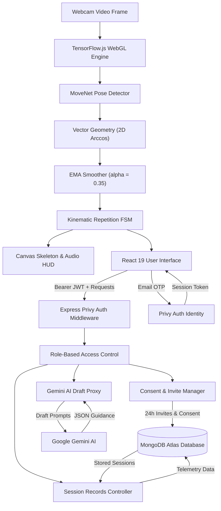
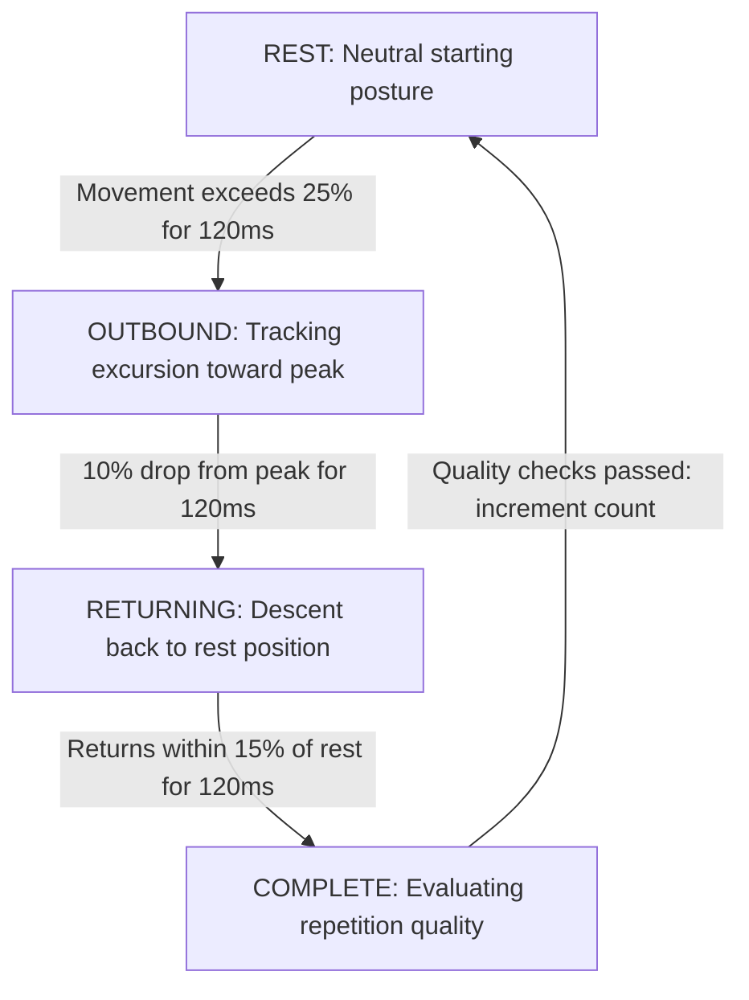
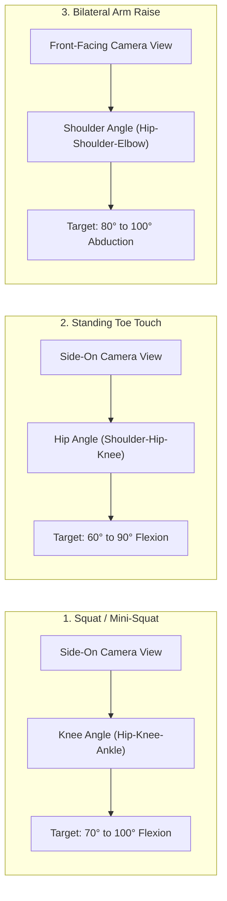
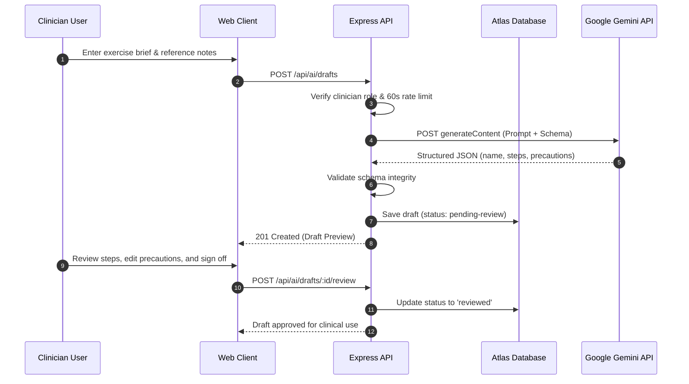
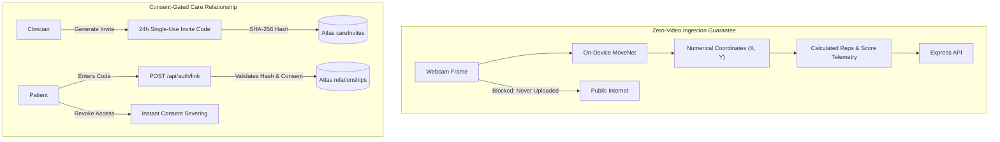
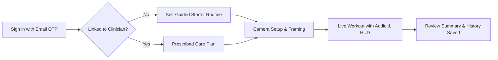
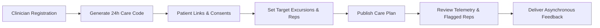

# ⚡ Kineticare
### *Intelligent Computer Vision Tele-Rehabilitation & Clinician-Guided Home Exercise*

---

[](https://nodejs.org/)
[](https://react.dev/)
[](https://vitejs.dev/)
[](https://www.tensorflow.org/js)
[](https://expressjs.com/)
[](https://www.mongodb.com/atlas)
[](https://privy.io/)
[](https://deepmind.google/technologies/gemini/)

---

## 💡 What is Kineticare?

**Kineticare** is a privacy-first tele-rehabilitation platform connecting physiotherapists with patients practicing at home. It addresses the **65% to 80% non-adherence rate** in home exercise programs by turning any webcam into a real-time clinical guidance and biomechanics tracking tool.

```
+─────────────────────────────────────────────────────────────────────────+
|                           KINETICARE CARE LOOP                          |
|                                                                         |
|  CLINICIAN PORTAL                        PATIENT WORKOUT HUD            |
|  • Prescribe target excursion (e.g. 85°) • On-device MoveNet tracking   |
|  • Review flagged outlier reps           • Live audio & skeleton cues   |
|  • Send asynchronous feedback            • Zero video leaves device     |
|          ▲                                          │                   |
|          └─────────────[ EXPRESS 5 API ]────────────┘                   |
|                      Consent-Gated Telemetry                            |
+─────────────────────────────────────────────────────────────────────────+
```

### Key Pillars
* 🔒 **Zero-Video Upload Guarantee:** 100% of pose estimation occurs on-device in WebGL using MoveNet. Raw camera video **never** leaves the browser.
* 📐 **Real-Time Biomechanics:** Sub-millisecond calculation of joint angles (knee flexion, hip hinge, shoulder abduction), tempo, and eccentric-to-concentric ratios.
* 🩺 **Clinician-in-the-Loop:** Clinicians prescribe tailored targets, inspect telemetry summaries, and send targeted feedback without having to watch hours of video.
* 🤖 **AI-Assisted Education:** Clinicians draft structured, textbook-referenced exercise guides with Google Gemini, guarded by a strict human review gate.

---

## ⚡ Quick Start (Up & Running in 2 Minutes)

### Prerequisites
* **Node.js 22.12+** (`node -v`)
* A working webcam

### 1. Clone & Install
```bash
git clone https://github.com/your-username/Kineticare.git
cd Kineticare
npm install
```

### 2. Configure Environment
Copy `.env.example` to `.env` in the root folder:
```ini
PORT=3001
FRONTEND_PORT=3000
PRIVY_APP_ID=your-privy-app-id
PRIVY_APP_SECRET=your-privy-app-secret
MONGODB_URI=mongodb+srv://<user>:<password>@cluster0.mongodb.net/?retryWrites=true&w=majority
MONGODB_DB=kineticare
GEMINI_API_KEY=your-gemini-key
GEMINI_MODEL=gemini-1.5-flash
```
And add your Privy App ID to `frontend/.env.local`:
```ini
VITE_PRIVY_APP_ID=your-privy-app-id
```

### 3. Launch
```bash
# Starts both frontend (port 3000) and backend (port 3001) simultaneously
npm run dev
```
Open **`http://localhost:3000`** in your browser.

---

## 🏛 System Architecture

### Visual Data Pipeline

```
+─────────────────────────────────────────────────────────────────────────+
|                  PATIENT & CLINICIAN BROWSER (React 19)                 |
|                                                                         |
|  [ Webcam Stream ]                                                      |
|         │                                                               |
|         ▼                                                               |
|  [ TensorFlow.js (WebGL) ] ──▶ [ MoveNet Pose (17 Keypoints) ]          |
|                                       │                                 |
|                                       ▼                                 |
|  [ UI & Audio Cues ] ◀── [ Rep FSM ] ◀── [ Vector Geometry & EMA ]      |
+───────────────────────────────────┬─────────────────────────────────────+
                                    │ HTTP / Bearer JWT
                                    ▼
+─────────────────────────────────────────────────────────────────────────+
|                    EXPRESS 5 BACKEND API (Port 3001)                    |
|                                                                         |
|  [ Privy Auth Middleware ] ──▶ [ Role-Based Access Control (RBAC) ]     |
|                                       │                                 |
|         ┌─────────────────────────────┼─────────────────────────────┐   |
|         ▼                             ▼                             ▼   |
|  [ Consent Manager ]        [ Session Records ]             [ AI Proxy ]|
+─────────┬─────────────────────────────┬─────────────────────────────┬───+
          │                             │                             │
          ▼                             ▼                             ▼
+──────────────────────────+  +──────────────────────────+  +────────────+
|   MongoDB Atlas (DB)     |  |   Privy Cloud (Identity) |  | Google AI  |
|   Users, Relationships,  |  |   Passwordless Email OTP |  | Gemini     |
|   Sessions & Plans       |  |   & Session Tokens       |  | Clinical   |
+──────────────────────────+  +──────────────────────────+  +────────────+
```

### Flowchart Architecture



---

## 👁 Computer Vision & Biomechanics Engine

### 1. MoveNet 17-Keypoint Anatomical Mapping

MoveNet computes coordinates `(x, y)` and confidence score `s in [0, 1]` for 17 key landmarks in real time:

```
                  [0] Nose
              [1] L.Eye     [2] R.Eye
              [3] L.Ear     [4] R.Ear
                   \         /
             [5] L.Shoulder ─── [6] R.Shoulder
             │       │              │       │
             │   [7] L.Elbow    [9] R.Elbow │
             │       │              │       │
             │   [8] L.Wrist   [10] R.Wrist │
             │                              │
            [11] L.Hip ────────── [12] R.Hip
                  │                    │
             [13] L.Knee          [14] R.Knee
                  │                    │
             [15] L.Ankle         [16] R.Ankle
```

### 2. Joint Angle Mathematics
Joint angles are calculated dynamically using the 2D dot product between directional limb vectors:

Given vertex joint $V$ and adjacent points $A$ and $B$:
* Vector $\vec{u} = A - V = (x_a - x_v, \; y_a - y_v)$
* Vector $\vec{w} = B - V = (x_b - x_v, \; y_b - y_v)$

$$\theta = \arccos\left( \frac{\vec{u} \cdot \vec{w}}{\|\vec{u}\| \|\vec{w}\|} \right) \times \frac{180^\circ}{\pi}$$

* **Safety Clamp:** The cosine quotient is clamped to $[-1.0, 1.0]$ before computing $\arccos$ to eliminate floating-point NaN exceptions.
* **Visibility Gate:** Angles are only computed when all 3 landmarks meet the visibility threshold (`score >= 0.30`).

### 3. Signal Smoothing (EMA Filter)
To eliminate camera noise and micro-jitter without adding latency:

$$\theta_{filtered}(t) = \alpha \cdot \theta_{clamped}(t) + (1 - \alpha) \cdot \theta_{filtered}(t - 1)$$

* Default smoothing factor: $\alpha = 0.35$.
* **Spike Limiter:** If $|\theta(t) - \theta(t-1)| > 45^\circ$, the change is step-limited to $45^\circ$ to prevent tracking glitch artifacts from triggering false reps.

---

## ⚙️ Repetition Finite State Machine (FSM)

Repetitions are tracked using a dwell-state hysteresis automaton:

```
   +──────────────────────────────────────────────────────────────+
   |                                                              |
   |   [ REST ] ──(exceeds 25% excursion for 120ms)──▶ [ OUTBOUND ]
   |      ▲                                                 │     |
   |      │                                                 │     |
   |   (within 15% of rest                            (10% drop   |
   |    for 120ms)                                     from peak) |
   |      │                                                 │     |
   |      │                                                 ▼     |
   |   [ COMPLETE ] ◀─────────────────────────────── [ RETURNING ]|
   |                                                              |
   +──────────────────────────────────────────────────────────────+
```



### FSM Quality Gates
| Gate | Condition | Clinical Purpose |
| :--- | :--- | :--- |
| **Duration Check** | $\Delta t \ge 600\text{ ms}$ | Rejects sudden spasms and tracking glitches |
| **Plausibility Check** | $\text{Peak} \le 1.6 \times \text{Target}$ | Rejects tracking drops or anatomically impossible hyperextension |
| **Target Check** | $\text{Peak} \in [\text{Target}_{min}, \text{Target}_{max}]$ | Confirms whether the repetition achieved prescribed excursion |
| **Tempo Analysis** | $t_{eccentric} / t_{concentric}$ | Measures control during the eccentric return phase |

---

## 🏃 Supported Exercises

```
   1. SQUAT / MINI-SQUAT
      • View: Side-On Camera
      • Angle: Knee Flexion (Hip -> Knee -> Ankle)
      • Target Range: 70° to 100° Excursion

   2. STANDING TOE TOUCH
      • View: Side-On Camera
      • Angle: Hip Hinge (Shoulder -> Hip -> Knee)
      • Target Range: 60° to 90° Flexion

   3. BILATERAL SIDE ARM RAISE
      • View: Front-Facing Camera
      • Angle: Shoulder Abduction (Hip -> Shoulder -> Elbow)
      • Target Range: 80° to 100° Abduction
```



### Automatic Setup & Alignment Assistance
* **Side-View Verification:** Detects if the patient is accidentally facing the camera during squats by calculating the horizontal shoulder spread ratio $\Delta x / \Delta y$. If $> 0.45$, the app prompts: *"Please turn side-on to the camera"*.
* **Framing Distance:** Ensures the patient is framed from head to ankles. Prompts to step back if height exceeds $95\%$ of frame or step closer if $< 40\%$.

---

## 🤖 Gemini AI Clinical Assistant

Clinicians can generate structured, textbook-referenced exercise guides through Google Gemini with a built-in safety gate:



> [!IMPORTANT]
> **Safety Rule:** AI drafts remain flagged as `unmeasured` and **cannot** be assigned to patients until manually reviewed and approved by a clinician.

---

## 🔒 Security, Privacy & Consent Architecture



1. **No Video Streaming:** Raw webcam frames are processed exclusively in GPU memory in the browser. Only numerical telemetry (rep counts, angles, duration) is sent to the backend.
2. **24-Hour Hashed Invites:** Clinician invite codes are generated using 24 cryptographically random bytes, stored as **SHA-256 hashes**, and expire automatically after 24 hours.
3. **One-Click Consent Revocation:** Patients retain sovereign control over their records. Revoking access from the patient panel immediately severs the relationship and terminates clinician data access.
4. **Isolated Workspaces:** Telemetry records use composite keys (`patientId:kind:id`). Clinicians can only query sessions for patients with an active, unrevoked consent record.

---

## 🔄 User Journeys

### Patient Journey


### Clinician Journey


---

## 🧪 Verification & Test Suite

Kineticare includes comprehensive test suites across front-end kinematics, back-end security boundaries, and launcher health:

```bash
# Run kinematics, geometry, and patient flow tests
npm test

# Run backend auth boundary, consent, and immutable record tests
npm run test:backend

# Run frontend ESLint code style checks
npm run lint

# Verify full production build
npm run build

# Run launcher integration & occupied port checks
node --test scripts/launch.test.mjs
```

---

## 📁 Repository Structure

```
Kineticare/
├── backend/                         # Express 5 Backend API
│   ├── routes/                      # API routes (ai, auth, records, analytics)
│   ├── services/                    # Atlas, Privy identity, and reference services
│   ├── test/                        # Backend auth and permission test suite
│   └── server.js                    # Express application entrypoint
├── frontend/                        # React 19 + Vite 8 Single Page App
│   ├── public/                      # Static assets & bundled video demonstrations
│   ├── src/
│   │   ├── exercise/                # FSM rep engine, measurements, and scoring
│   │   ├── patient/                 # Patient screens (Dashboard, Plans, Info)
│   │   ├── records/                 # Clinician screens (Roster, Review Queue)
│   │   ├── session/                 # Live workout execution HUD & summary
│   │   └── vision/                  # MoveNet pose tracking, geometry, and EMA filter
│   └── vite.config.js               # Vite config with API proxy
├── docs/                            # Deep-dive engineering documentation
│   ├── FEATURE_ROADMAP.md           # Engineering roadmap & validation criteria
│   ├── GEMINI_ATLAS_SETUP.md        # Gemini LLM configuration guide
│   ├── PATIENT_FLOW.md              # State transition specifications
│   └── PRIVY_ATLAS_SETUP.md         # Privy authentication & Atlas setup guide
├── scripts/                         # Build, launcher & diagnostic scripts
├── DEPLOYMENT.md                    # Production hosting & reverse-proxy deployment guide
└── package.json                     # Root NPM workspace configuration
```

---

## ⚠️ Clinical Disclaimers & Limitations

* **Prototype Status:** Kineticare is a research and clinical prototype. It does not diagnose, treat, or prevent any musculoskeletal condition.
* **2D Planar Limitations:** Single 2D webcam tracking cannot capture out-of-plane rotational movements, knee valgus collapse, or spinal compression with the precision of a multi-camera 3D motion lab.
* **Medical Supervision:** All exercise programs should be evaluated and approved by a licensed physical therapist or medical professional. Patients experiencing acute pain or dizziness should cease exercise immediately.

---

<div align="center">
  <sub>Kineticare • Camera-Guided Care Bridge for Physical Therapy</sub>
</div>

---

## Knowledge-grounded chat and animation previews

Clinicians can open Exercise Library to ask Gemini with retrieved textbook evidence, inspect source citations and render a labelled mini-squat engineering preview as a downloadable video. The supplied extraction prompt is included verbatim as a system instruction, followed by runtime instructions. Other variations remain text-only until compatible reviewed motions exist. This feature does not approve exercises or enable patient assignment. See [setup, endpoints and verification](docs/GEMINI_KNOWLEDGE_ANIMATION.md).
