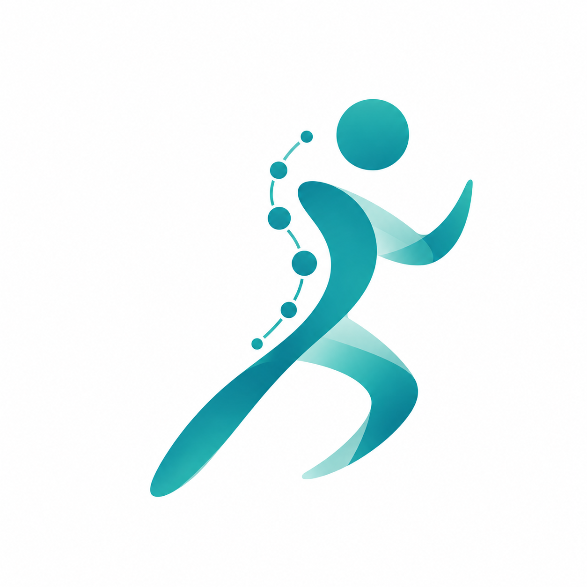
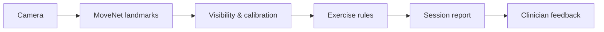

<p align="center">
  
</p>

<h1 align="center">Kineticare</h1>
<p align="center"><strong>From prescribed movement to meaningful feedback.</strong></p>
<p align="center">Camera-guided home exercise that keeps patients and clinicians connected between appointments.</p>

<p align="center">
  <a href="#why-kineticare">The idea</a> ·
  <a href="#explore-the-experience">The experience</a> ·
  <a href="#how-it-works">The technology</a> ·
  <a href="#scope-and-next-steps">The roadmap</a> ·
  <a href="frontend/README.md">Setup & commands</a>
</p>

<p align="center">
  
  <br><sub>Illustrated MoveNet workflow · Expand your understanding below</sub>
</p>

## Why Kineticare?

An exercise plan is only the start of rehabilitation. At home, patients can forget the demonstration, feel unsure about their movement, or struggle to describe what happened. Between appointments, clinicians have limited visibility into that practice.

Kineticare connects those moments. A reviewed demonstration becomes an individual assignment; camera-observed movement becomes a concise session report; that report becomes a conversation with the clinician.

The project was built around the Devlympics theme of bridging a gap: the distance between instructions given in a consultation and exercises practiced at home. Its goal is clearer guidance and more useful follow-up. Improvements in adherence, workload, or recovery remain outcomes to evaluate.

## The care loop

| Stage | What happens | What carries forward |
| --- | --- | --- |
| Demonstrate | A clinician records and approves an exercise reference | A playable, versioned demonstration |
| Personalize | The clinician chooses targets, repetitions, schedule, and notes | A patient-specific assignment |
| Prepare | The patient watches instructions, positions the camera, and calibrates | A stable starting pose |
| Practice | The app follows supported movement and provides cues | Repetitions, range, tempo, and timing |
| Review | The patient submits a completed or partial session | A compact report with tracking gaps |
| Respond | The clinician reviews the record and sends feedback | Guidance the patient can read and question |

## Explore the experience

<details open>
<summary><strong>Patient · Know what to do and see what happened</strong></summary>

Patients can view their assigned plan, read clinician notes, and play the approved reference before starting. The preparation checklist and stable-rest calibration help establish the required camera view.

During practice, the live screen displays body landmarks, movement cues, repetition progress, and timing. Patients can switch between the camera overlay and skeleton view, use optional spoken cues, pause, resume, or stop early.

The summary explains completed work, range and tempo components, and periods when tracking was unavailable. Recovery drafts support interrupted sessions; history and progress views retain saved work. Feedback, session questions, and help requests keep the next conversation connected to the exercise.

</details>

<details>
<summary><strong>Clinician · Demonstrate once, personalize, and follow up</strong></summary>

Clinicians capture references inside Kineticare, mark five repetitions, preview the recording, and reject or approve the result. An approved reference provides a demonstration; the patient's target remains an individual choice.

Assignment drafts support reference selection, repetitions, targets, and notes, with a preview before publication. Published assignments preserve their versions so later changes do not rewrite the meaning of earlier sessions.

The dashboard brings together linked patients, session history, incomplete work, and requests. Clinicians can review measurements, mark sessions reviewed, send session-linked feedback, and reply to patient questions.

</details>

<details>
<summary><strong>Walk through a complete demonstration</strong></summary>

1. Enter the clinician account and capture an approved exercise reference.
2. Select a patient, draft an assignment, preview it, and publish.
3. Enter the matching patient account and watch the demonstration.
4. Complete positioning and calibration, then perform the assigned movement.
5. Try pause/resume, camera/skeleton switching, and a brief tracking interruption.
6. Save the session and inspect its measurements and history.
7. Return as the clinician, review the report, and send feedback.
8. Return as the patient, read the response, and ask a question.

The browser-local demo provides a clinician and two separate patient accounts. Firebase mode supports shared records across devices.

</details>

## Supported exercises

The MVP focuses on two movements with explicit camera requirements and measurement rules.

| Exercise | Camera view | What the app follows |
| --- | --- | --- |
| Squat / mini-squat | Side | Knee-angle excursion and a complete lowering/return cycle |
| Bilateral side arm raise | Front | Shoulder elevation and a complete raise/return cycle |

Each exercise has its own required landmarks, calibration, movement phases, and cues. The app uses the assigned exercise to select those rules. It does not attempt to classify arbitrary exercises.

## How it works



MoveNet SinglePose Lightning estimates body landmarks in the browser. Kineticare checks whether the relevant joints are visible, derives exercise-specific angles, and tracks movement phases relative to the patient's calibration and assignment.

A repetition is counted from a complete configured movement cycle. When tracking becomes unreliable, the app reports that it cannot assess the movement and discards an incomplete cycle rather than joining motion across a gap.

<details>
<summary><strong>Understand the session report</strong></summary>

| Measurement | Meaning |
| --- | --- |
| Repetitions | Completed cycles detected by the configured exercise rules |
| Active time | Assessed movement time while tracking is usable |
| Pauses and elapsed time | How the session was spent beyond active movement |
| Tracking gaps | Time when required landmarks could not be assessed |
| Range and tempo | Observed movement relative to the assigned target |
| Prototype score | An explained summary of configured movement criteria |

These observations support clinician review. They do not establish diagnosis, treatment effectiveness, or complete movement safety. The README animation is an authored illustration rather than a recording of model inference.

</details>

## What makes the project useful

Kineticare connects the demonstration, individual target, session evidence, and response. A repetition counter alone cannot explain which assignment was followed; a recording alone asks someone to watch the entire session. Here, the reference and assignment versions give the compact report context.

The design also makes incomplete information visible. Partial sessions can be saved, pauses remain distinct from active time, and tracking gaps appear in the report. Patients and clinicians can discuss what was observed without treating every open-camera minute as completed exercise.

## Technology and data

| Layer | Implementation |
| --- | --- |
| Interface | React, Vite, Tailwind CSS, responsive patient and clinician white-mode UI |
| Backend & API | Node.js, Express REST API, modular Exercise Registry, Biomechanics Engine |
| Pose estimation | TensorFlow.js and MoveNet SinglePose Lightning (on-device WebGL) |
| Movement logic | Exercise-specific geometry, calibration, concentric/eccentric phases, and fatigue scoring |
| Identity | Firebase Authentication with provisioned roles (Patient: Shyam Yadav, Clinician: Dr. Aditi Singh) |
| Shared records | Cloud Firestore assignments, sessions, clinical feedback, and requests |
| Reference media | Protected Cloud Storage in Firebase mode; IndexedDB & local staging fallback |

Patient camera frames are processed on the device. Raw patient workout video is not recorded or uploaded by default. Explicitly approved clinician reference clips are stored for authorized playback.

Roles and clinician-patient relationships are provisioned through a trusted process. Firestore and Storage rules restrict records and reference media to the relevant accounts.

<details>
<summary><strong>Explore the project structure</strong></summary>

```text
backend/
  config/      Server and environment definitions
  routes/      Express routers: /api/exercises, /api/analytics, /api/reports
  services/    Exercise registry, biomechanical calculation, SOAP note generation
  server.js    Production fullstack server
frontend/
  src/
    auth/      Account and role state (Shyam Yadav & Dr. Aditi Singh)
    client/    Clinician dashboard, patient drilldowns, and reference capture
    patient/   Setup, live practice, summaries, and recovery progress
    exercise/  Exercise definitions, repetition engine, scoring
    vision/    Camera lifecycle, MoveNet, geometry
    records/   Shared records and local workspace state
    services/  Backend API client, Firebase, and media storage
    session/   Recoverable workout drafts
  test/        Logic and security-rule checks
docs/assets/   Project illustrations
```

</details>

## Scope and next steps

The implemented fullstack architecture covers the camera-guided workflow, reference capture and playback, versioned assignments, live camera measurements, recoverable sessions, clinician review, SOAP note generation, exercise issue reporting, and patient requests.

Planned extensions on the roadmap:

- **Clinician Custom Video Upload (Phase 2)**: Stage 1 preview with local staging is currently accessible in the Exercise Library. Persistent cloud transcoding, adaptive streaming, and multi-tenant video distribution are scheduled for Phase 2.
- **Dynamic Exercise Expansion**: Developers can push new protocols directly via `backend/services/exerciseRegistry.js` or `POST /api/exercises`.
- **EHR Integration**: Export structured clinical SOAP notes to FHIR-compliant electronic medical records.
- **Native Mobile Apps**: Cross-platform mobile wrappers (React Native/Capacitor) building on this responsive web foundation.

## Documentation

| Read | For |
| --- | --- |
| [Frontend README](frontend/README.md) | Installation, run commands, Firebase setup, and checks |
| [Project overview](overview.md) | Problem, users, product decisions, and demonstration narrative |
| [Implementation plan](plan.md) | Architecture, record contracts, permissions, and release gates |

The overview and plan retain the original planning baseline; current behavior is established by the code and verified checks.

---

<p align="center"><strong>Demonstrate. Practice. Understand. Respond.</strong></p>

